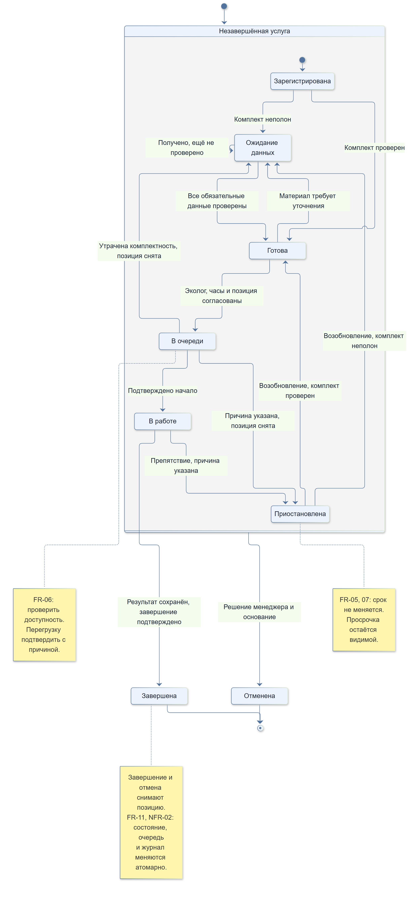
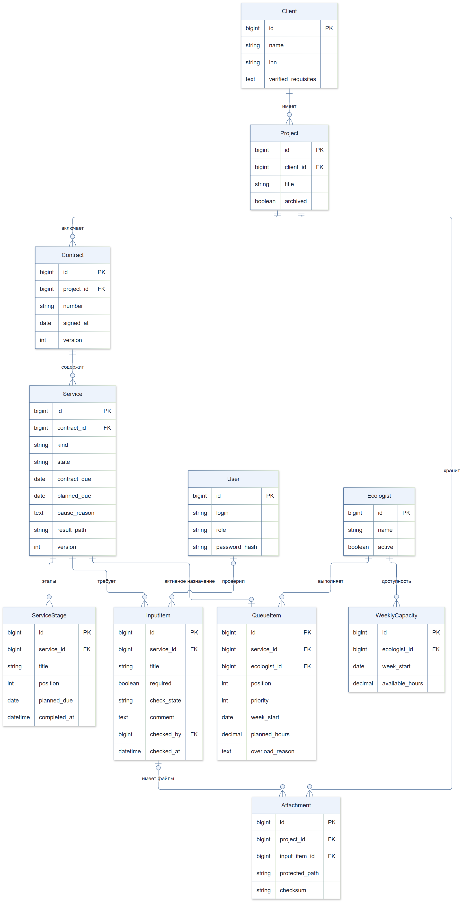
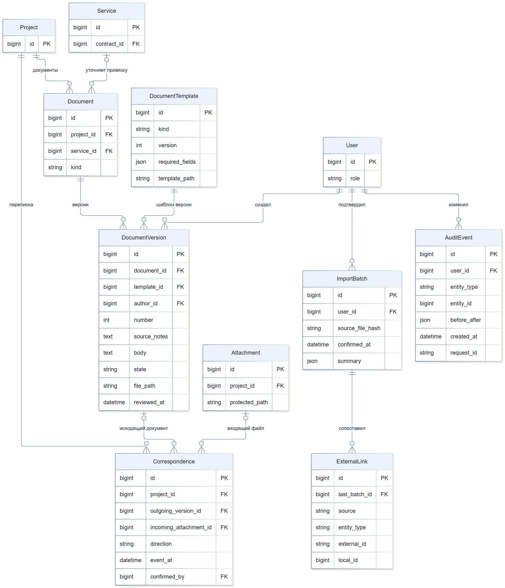
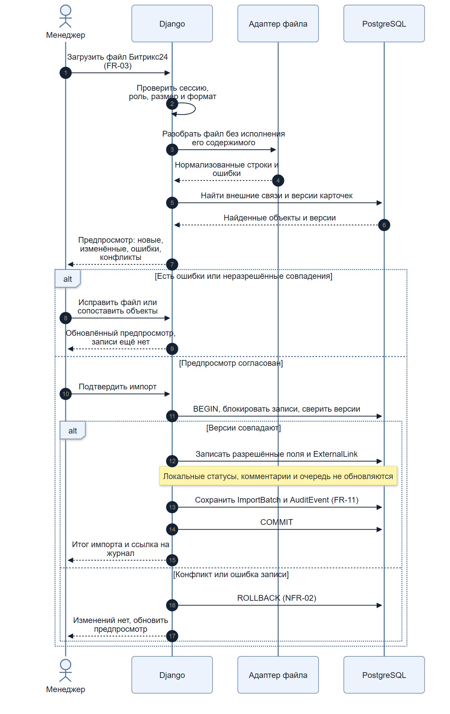
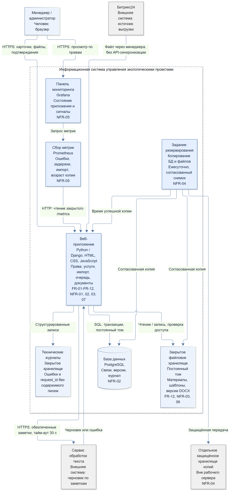
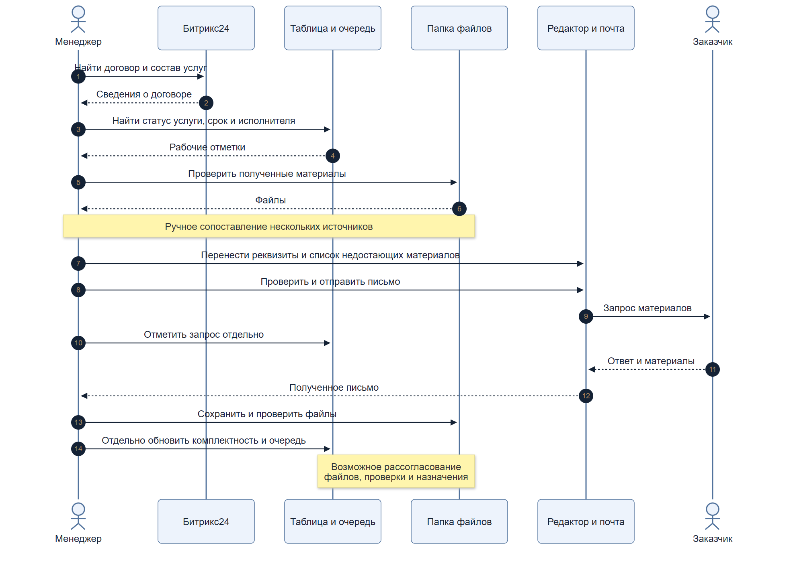
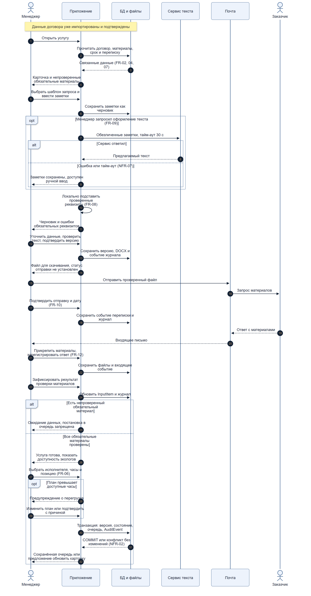

# ЛР 3 - Проектирование информационной системы

**Тема ВКР:** Проектирование и разработка информационной системы для управления экологическими проектами

**Автор:** Маркозубова Анастасия Кирилловна, группа К3439. Работа выполняется индивидуально.

## 1. Предметная область и требования

### 1.1. Предметная область и границы системы

Система предназначена для менеджера экологических проектов. Она объединяет сведения о клиентах, договорах и услугах, помогает проверять исходные данные, распределять работы между экологами и готовить документы. Данные из Битрикс24 менеджер загружает вручную из файлов.

Менеджер одновременно ведёт несколько договоров. Каждый договор включает услуги, например разработку экологической документации или сопровождение согласования. Их готовность различается: по одной услуге материалы уже проверены, по другой ещё ожидается ответ заказчика. Поэтому ход работ нужно учитывать по каждой услуге. Одного общего статуса договора для назначения работы экологу недостаточно.

Сейчас сведения распределены между Битрикс24, таблицами, папками с файлами и перепиской. Чтобы проверить готовность работы, менеджер сопоставляет записи в этих инструментах. В приложении договор, перечень материалов, результаты проверки, исполнитель, срок и история писем будут доступны в карточке услуги.

Менеджер ведёт рабочие карточки, администратор управляет учётными записями и обслуживает приложение. Эколог учитывается как исполнитель без отдельного личного кабинета. Заказчик передаёт материалы вне системы. В первую версию не входят автоматическая синхронизация с Битрикс24, отправка писем, юридическое согласование документов и автоматическая оптимизация расписания.

Отчёт описывает проект системы. Численные показатели в требованиях приняты как проектные допущения; их предстоит проверить после реализации. Хронометраж текущего процесса на этом этапе не проводился.

### 1.2. Функциональные требования

| ID | Требование | Как проверить выполнение |
| --- | --- | --- |
| FR-01 | Вход по учётной записи с ролями менеджера и администратора. Менеджер ведёт проекты, администратор дополнительно управляет пользователями. | Проверить разрешённые действия каждой роли и отказ при обращении без входа. |
| FR-02 | Вести клиентов, проекты, договоры и услуги. Услуга принадлежит одному договору, договор - одному проекту, проект - одному клиенту. | Создать клиента, проект, договор и две услуги; открыть их связи из карточки проекта. |
| FR-03 | Загружать файл Битрикс24 вручную с предварительным просмотром, проверкой обязательных полей, дублей и конфликтов. Подтверждённый импорт не должен затирать локальные статусы, комментарии и очередь. | Повторно загрузить один файл: новых дублей нет, локальный комментарий сохранён. Конфликтующее изменение показано менеджеру до записи. |
| FR-04 | Для каждой услуги вести перечень исходных данных со статусами «не запрошено», «запрошено», «получено», «проверено», «требует уточнения», признаком обязательности и ссылкой на файл. | Полученный, но не проверенный обязательный материал не делает услугу готовой к постановке в очередь. |
| FR-05 | Учитывать состояние услуги, этапы, договорный и плановый сроки, причину приостановки и историю изменений. | Приостановить услугу с причиной; убедиться, что изменение сохранено в истории, а договорный срок не изменился. |
| FR-06 | Назначать эколога и место услуги в его очереди с учётом приоритета, готовности данных и доступности. Показывать плановые часы и доступные часы за неделю. | Попытка поставить неготовую услугу в очередь отклоняется; превышение недельной доступности требует явного подтверждения менеджера. |
| FR-07 | Показывать просроченные услуги и услуги, у которых плановый срок наступает в ближайшие семь календарных дней, с фильтрами по проекту, исполнителю и причине ожидания. | Для фиксированной контрольной даты сопоставить список с заданными сроками и состояниями. |
| FR-08 | Готовить запросы исходных данных, сопроводительные письма и доверенности по шаблонам с подстановкой проверенных реквизитов. | По выбранной услуге сформировать DOCX; при отсутствии обязательного реквизита показать ошибку и не выпускать итоговый файл. |
| FR-09 | По запросу менеджера преобразовывать его заметки в черновик официального письма через внешний сервис обработки текста. Сохранять исходные заметки и давать возможность исправить черновик. | Сопоставить заметки, ответ сервиса и отредактированный текст. Недоступность сервиса не блокирует ручное составление письма. |
| FR-10 | Хранить версии документов и историю переписки в проекте с необязательной привязкой к услуге. Отдельно учитывать подготовку документа и подтверждённую менеджером отправку или получение. | Создать две версии письма; убедиться, что обе доступны, а формирование файла не устанавливает дату отправки. |
| FR-11 | Записывать автора, время и содержание изменений услуги, очереди, импорта и документа в журнал событий. | Изменить состояние и приоритет услуги; найти соответствующие записи с прежними и новыми значениями. |
| FR-12 | Загружать и скачивать файлы проекта через приложение с проверкой доступа. | После выхода из учётной записи ссылка на вложение не открывается; после входа доступный файл скачивается. |

### 1.3. Нефункциональные требования

| ID | Требование | Как проверить выполнение |
| --- | --- | --- |
| NFR-01 | При 10 одновременно работающих пользователях и 10 000 услугах 95-й процентиль времени ответа карточки и списка услуг с фильтрами не превышает 2 с. Импорт и внешний сервис измеряются отдельно. | Нагрузочный прогон на стенде Linux, 4 vCPU, 8 ГБ ОЗУ, SSD; не менее 1 000 запросов после прогрева. Время измеряется на сервере. |
| NFR-02 | Изменение связанных данных выполняется атомарно. Повторный импорт не создаёт дублей. Одновременное редактирование карточки не должно приводить к потере изменений без сообщения о конфликте. | Имитировать ошибку в середине импорта и конкурентное сохранение: частичные записи отсутствуют, второму редактору показан конфликт версии. |
| NFR-03 | Доступ к рабочей среде разрешён по HTTPS. Пароли хранятся в виде стойких хешей средствами Django. Проверяются роли, CSRF и доступ к вложениям; секреты не попадают в репозиторий, журналы и запросы внешнему сервису. | Проверить отрицательные сценарии доступа, настройки среды и журналирование; использовать обезличенный текст для внешнего запроса. |
| NFR-04 | Резервная копия БД и файлов создаётся ежедневно и хранится отдельно от рабочего сервера. Целевая потеря данных при сбое - не более 24 ч, восстановление на подготовленном стенде - не более 2 ч. | Восстановить согласованную копию БД и файлов в изолированной среде, проверить связи и скачивание вложений, измерить время. |
| NFR-05 | Приложение предоставляет метрики HTTP-запросов, ошибок, длительности импорта и возраста последней успешной копии. Журналы содержат идентификатор запроса; при остановке приложения сигнал появляется на панели не позднее 2 мин. | Остановить приложение, вызвать контролируемую ошибку и просрочить тестовую отметку копии; проверить панель и связь ошибки с записью журнала. |
| NFR-06 | Развёртывание выполняется через Docker Compose из зафиксированных версий зависимостей. После перезапуска контейнеров данные и вложения сохраняются. | Развернуть приложение на чистом стенде по инструкции, создать запись и вложение, пересоздать контейнеры и проверить сохранность. |
| NFR-07 | Ожидание внешнего сервиса ограничено 30 с. При ошибке заметки и карточка сохраняются, повторный запрос выполняется только по действию менеджера, доступно ручное редактирование. | Подменить ответ сервиса тайм-аутом и ошибкой; проверить сохранность заметок и возможность подготовить письмо вручную. |

## 2. Обзор нотаций и видов диаграмм

Для выбора моделей рассмотрены десять нотаций и видов диаграмм. Виды UML-диаграмм приведены отдельно: каждый из них описывает свою сторону системы.

| Нотация или вид диаграммы | Что описывает | Сильные стороны |
| --- | --- | --- |
| BPMN | Бизнес-процессы, участников, события и обмен сообщениями. | Удобна для передачи работы между менеджером, заказчиком и экологом, ожидания ответа и повторных запросов. |
| IDEF0 | Функции, их входы, выходы, управление и механизмы выполнения. | Помогает отделить исходные материалы от правил договора и исполнителей, декомпозировать крупные функции. |
| ER-модель | Сущности, атрибуты и кратности связей. | Показывает структуру БД, обязательность связей и возможные дубли. |
| DFD | Потоки данных между процессами, хранилищами и внешними участниками. | Показывает, откуда приходят файлы Битрикс24 и куда попадают сведения о договорах и документах. |
| UML: варианты использования | Цели пользователей и границу системы. | Помогает определить состав функций и отделить действия менеджера от внешних процессов. |
| UML: классы | Статическую структуру объектов, их свойства и отношения. | Подходит для проектирования программных объектов и распределения ответственности между ними. |
| UML: последовательности | Порядок сообщений между участниками сценария. | Показывает подтверждения, транзакции, ошибки импорта и вызовы внешнего сервиса. |
| UML: активности | Действия, ветвления и параллельные ветви процесса. | Удобна для алгоритма обработки материалов и подготовки документа. |
| UML: состояния | Жизненный цикл объекта и условия переходов. | Задаёт условия готовности, приостановки и завершения услуги. |
| C4: контейнеры | Приложения и хранилища внутри системы, внешних участников и связи. | Даёт общий взгляд на архитектуру, технологии, границы ответственности и точки отказа. |

## 3. Выбор нотаций для проекта

Для проекта выбраны диаграмма состояний, ER-модель, диаграммы последовательности и контейнерная модель C4. Вместе они описывают правила работы с услугой, структуру БД и обмен данными между частями приложения. Текущий и целевой процессы сравниваются на UML-диаграммах последовательности.

| Вид модели | Что моделируется | Связанные требования | Почему подходит |
| --- | --- | --- | --- |
| UML: состояния | Путь услуги от регистрации до завершения или отмены. | FR-04, FR-05, FR-06, FR-07, FR-11; NFR-02. | Условия переходов исключают запуск работы с непроверенными материалами и потерю причины ожидания. |
| ER-модель | Проекты, услуги, материалы, очередь, документы, импорт и журнал. | FR-01-FR-06, FR-08-FR-12; NFR-02, NFR-03. | Связи и ограничения задают целостность данных, повторяемость импорта и хранение версий. |
| UML: последовательности | Импорт; текущий и целевой сценарии получения данных и подготовки запроса. | FR-01, FR-03-FR-12; NFR-02, NFR-03, NFR-07. | Видно, кто принимает решение, когда выполняется запись и как обрабатывается отказ сервиса. |
| C4: контейнеры | Веб-приложение, БД, файлы, сервис обработки текста, мониторинг и копии. | FR-01, FR-03, FR-08-FR-12; NFR-01, NFR-03-NFR-07. | Показывает, какие части системы отвечают за доступ, хранение, метрики и резервирование. |

## 4. Модели системы

В отчёт включены семь диаграмм: состояния услуги, две ER-модели, импорт, архитектура и процессы AS-IS / TO-BE.

### 4.1. Жизненный цикл услуги: UML-диаграмма состояний

**Рисунок 1 - Жизненный цикл услуги.**

При регистрации услуги менеджер составляет перечень обязательных материалов. Пока хотя бы один из них отсутствует, не проверен или требует уточнения, услуга ожидает данные. Загрузки файла недостаточно для постановки в очередь: сначала нужно подтвердить его пригодность для работы (FR-04).

После проверки всех обязательных материалов услуга получает состояние «Готова». Менеджер выбирает эколога, указывает плановые часы и место в очереди. Если часов больше, чем доступно на неделе, приложение предупреждает о перегрузке. Менеджер меняет план или подтверждает превышение с указанием причины (FR-06). Очередь составляется вручную, автоматический поиск оптимального расписания не предусмотрен.

Начало работы подтверждает менеджер. Если до этого обязательный материал признан непригодным, услуга снимается с активной очереди и возвращается к ожиданию данных. Если проблема выявлена во время работы, менеджер приостанавливает услугу и записывает причину. Завершённые этапы и прежняя позиция сохраняются в истории.

Чтобы возобновить услугу, менеджер повторно проверяет комплектность и назначает место в очереди. Для завершения он сохраняет результат и подтверждает выполнение. При завершении или отмене активная позиция освобождается.

Приостановка не меняет договорный срок. Для его изменения нужно отдельное основание. Просрочка рассчитывается для всех незавершённых и неотменённых услуг, включая приостановленные (FR-05, FR-07).

Новое состояние, очередь и событие журнала сохраняются одной транзакцией. Перед записью приложение сверяет версию карточки: если другой пользователь уже изменил её, сохранение останавливается с сообщением о конфликте (NFR-02, FR-11).

### 4.2. Основные данные: ER-модель

**Рисунок 2 - Основные сущности.**

В ER-модели использована нотация «воронья лапка»: `||` означает ровно один объект, `o{` - от нуля до многих, `o|` - ноль или один. Первичные и внешние ключи отмечены как `PK` и `FK`. На схеме показаны основные поля и связи; полный состав таблиц будет уточняться при реализации.

Клиент связан с проектами, проект с договорами, а договор с услугами (FR-02). Состояние хранится у услуги: работы по одному договору могут проходить разные этапы независимо друг от друга.

В `InputItem` записываются название требуемого материала, его обязательность, состояние проверки и комментарий. Вложение `Attachment` принадлежит проекту и при необходимости связывается с одним пунктом перечня. У пункта может быть несколько файлов, в том числе исправленных. При переходе в состояние «проверено» сохраняются пользователь и время проверки (FR-04, FR-12).

В `ServiceStage` хранятся этапы услуги, плановые сроки и отметки о выполнении. `QueueItem` содержит активное назначение и позицию в очереди эколога. Для назначения указываются неделя и плановые часы, для исполнителя в `WeeklyCapacity` - доступные часы за неделю. Загрузка равна сумме часов активных назначений. На время отпуска или отсутствия доступные часы уменьшаются (FR-05, FR-06).

### 4.3. Документы и контроль изменений: ER-модель

**Рисунок 3 - Документы и контроль изменений.**

`Document` связывает документ с проектом и, при необходимости, с услугой. В `DocumentVersion` хранятся текст, исходные заметки, номер версии и путь к файлу. Версия проходит два состояния: «черновик» и «проверено менеджером».

Запись `Correspondence` указывает на проверенную версию исходящего документа или на вложение входящего сообщения. Для исходящего письма дата отправки появляется только после подтверждения менеджера (FR-08-FR-10).

В `DocumentTemplate` заданы тип и версия шаблона, обязательные реквизиты. Для доверенности нужны сведения о доверителе, представителе, сроке и полномочиях. Приложение подставляет проверенные значения. Если реквизитов или оснований полномочий нет, менеджер сначала уточняет их.

`ImportBatch` хранит сведения о загрузке и её подтверждении. Через `ExternalLink` локальная карточка связывается с идентификатором объекта в выгрузке. В `AuditEvent` записываются пользователь, тип и идентификатор объекта, прежние и новые значения, время и идентификатор запроса. Содержимое файлов и документов в журнал не копируется (FR-03, FR-11; NFR-03).

**Ограничения целостности и доступа:**

1. Для внешней связи уникальна комбинация `source + entity_type + external_id`. По названию клиента или номеру договора без других признаков автоматическое объединение не выполняется.
2. У услуги может быть не более одной активной записи очереди. Активная позиция уникальна внутри очереди одного эколога; перестановка выполняется транзакционно.
3. Номер версии уникален внутри документа. Подтверждённая версия не редактируется: правка создаёт следующую версию.
4. Приложение проверяет, что услуга, материал, файл и документ относятся к одному проекту. Внешние ключи не заменяют эту проверку.
5. Запись переписки содержит либо исходящую версию, либо входящее вложение, но не оба варианта одновременно. Для исходящей записи обязательны подтверждение и дата отправки.
6. Рабочие карточки с зависимыми документами архивируются. Их удаление каскадом не допускается. Обычный интерфейс не позволяет изменять или удалять журнал.
7. Автор изменения определяется по серверной сессии. Указанный клиентом идентификатор пользователя не используется как подтверждение авторства (FR-01, FR-11).

Уникальность и внешние ключи проверяет БД. Условия, затрагивающие несколько объектов, проверяет серверная логика. Вместе с контролем версий и транзакциями эти ограничения отвечают NFR-02. Проверка роли и принадлежности файла проекту отвечает NFR-03.

### 4.4. Ручной импорт: UML-диаграмма последовательности

**Рисунок 4 - Импорт файлов Битрикс24.**

Менеджер загружает файл. Приложение проверяет доступ и передаёт содержимое адаптеру формата, который приводит записи о клиенте, проекте, договоре и услугах к единому внутреннему представлению. Набор колонок будет определён по образцу выгрузки перед реализацией. Поддержку конкретных файлов Excel и HTML ещё предстоит проверить.

Перед записью менеджер видит новые строки, изменения, ошибки и неоднозначные совпадения. Если устойчивого идентификатора в выгрузке нет, он вручную выбирает соответствующую карточку. Пока ошибки и конфликты не разрешены, импорт нельзя подтвердить.

Импорт обновляет только разрешённые сведения о клиенте и договоре. Локальные статусы, комментарии, результаты проверки материалов и очередь сохраняются. При подтверждении приложение повторно сверяет версии карточек. Если обнаружен новый конфликт, транзакция откатывается и менеджер обновляет предварительный просмотр. При успешной проверке данные, внешние связи, пакет импорта и журнал сохраняются вместе (FR-03, FR-11; NFR-02).

### 4.5. Архитектура: C4, уровень контейнеров

**Рисунок 5 - Архитектура приложения.**

Контейнером в C4 называется приложение или хранилище; этот термин не равнозначен Docker-контейнеру. На схеме синим отмечены приложения, серым - внешние системы, цилиндром - БД. Пунктир обозначает границу системы, подписи на связях поясняют обмен данными.

Приложение спроектировано как монолит Django с серверными HTML-страницами и небольшими сценариями JavaScript. В нём сосредоточены проверка прав, работа с услугами, импорт и подготовка документов. Связанные данные хранятся в PostgreSQL. Файлы выдаёт обработчик приложения после проверки доступа; открытая раздача папки с вложениями не предусмотрена (FR-01, FR-12; NFR-03).

Импорт и генерация документов выполняются отдельными операциями и не включаются в обычное чтение карточки. Списки выдаются постранично. Для поиска по внешним идентификаторам, состоянию и срокам услуги, исполнителю и неделе очереди предусмотрены индексы. Достижение порога 2 с из NFR-01 будет проверяться под нагрузкой.

Во внешний сервис передаются обезличенные заметки для письма. После обработки текста приложение локально подставляет реквизиты, даты и полномочия. Менеджер просматривает черновик и подтверждает версию. Во время ожидания ответа транзакция БД не удерживается открытой. Если сервис недоступен, текст можно подготовить вручную (FR-08, FR-09; NFR-03, NFR-07).

Prometheus собирает метрики HTTP-запросов, ошибок, длительности импорта и возраста последней успешной копии. Панель показывает ошибки и недоступность приложения. По идентификатору запроса можно сопоставить техническую запись с событием приложения. Пароли, содержимое вложений и тексты писем в метрики и технические журналы не попадают (NFR-05).

Для развёртывания выбран Linux-стенд с Docker Compose. Версии приложения и зависимостей фиксируются, БД и файлы размещаются в постоянных томах. Во время резервирования запись кратковременно блокируется, чтобы получить согласованную копию БД и файлов. Копия передаётся в отдельное защищённое хранилище. Восстановление будет проверяться на отдельном стенде (NFR-04, NFR-06). Конфигурация развёртывания готовится на этапе реализации.

## 5. AS-IS и TO-BE

На обеих UML-диаграммах последовательности показан один сценарий: проверка готовности услуги, запрос недостающих материалов и постановка работы в очередь после их проверки. Назначение в системе фиксирует менеджер, а эколог получает его вне приложения.

### 5.1. AS-IS: сведения распределены между инструментами

**Рисунок 6 - AS-IS.**

Менеджер находит договор в Битрикс24, сверяет таблицу с файлами и составляет список недостающих материалов. Затем вручную переносит реквизиты и перечень в письмо, проверяет его и отправляет заказчику. Факт отправки отмечает отдельно. После ответа сохраняет и проверяет файлы, обновляет таблицу и очередь исполнителя.

Одно изменение приходится отражать в нескольких местах. Например, файл уже лежит в папке, но в таблице ещё нет отметки о проверке, а очередь не обновлена. Повторный запрос требует новой сверки. На схеме отмечены места, где сведения могут разойтись.

### 5.2. TO-BE: действия связаны с карточкой услуги

**Рисунок 7 - TO-BE.**

До начала сценария менеджер загружает и подтверждает сведения о договоре, как показано на рисунке 4. В карточке услуги он видит обязательные материалы, результаты их проверки, сроки и переписку. Приложение составляет перечень для запроса по непроверенным обязательным материалам (FR-04, FR-07).

Менеджер выбирает шаблон письма и при необходимости вводит заметки. Он может запросить их обработку внешним сервисом или написать текст вручную. Приложение подставляет реквизиты, менеджер проверяет версию и скачивает документ. После отправки вне системы он отдельно указывает её дату. Создание файла не устанавливает отметку об отправке (FR-08-FR-10).

После ответа клиента менеджер прикрепляет файлы и записывает результат проверки. Пока остаётся хотя бы один непроверенный обязательный материал, постановка в очередь запрещена. Для готовой услуги приложение показывает доступность экологов. Менеджер выбирает исполнителя и позицию; новое состояние, очередь и история сохраняются одной транзакцией (FR-05, FR-06, FR-11, FR-12; NFR-02).

### 5.3. Обоснование перехода

| Место на схеме AS-IS | Решение на схеме TO-BE | Ожидаемое изменение | Как оценить после реализации |
| --- | --- | --- | --- |
| Сопоставление Битрикс24, таблицы и папки. | Чтение связанной карточки услуги. | Сокращается поиск сведений по разным источникам. | Время поиска срока, исполнителя и недостающего материала на одинаковом наборе данных. |
| Ручной перенос реквизитов и списка в письмо. | Шаблон с локальной подстановкой и обязательной проверкой. | Уменьшается повторный ввод реквизитов. | Число ручных переносов и расхождений с карточкой в подготовленном документе. |
| Отдельные отметки о файле, проверке и очереди. | Единый перечень материалов и проверка готовности перед назначением. | Непроверенный файл не делает работу доступной исполнителю. | Попытка назначения услуги с неполным комплектом и время обновления готовой услуги. |
| Отдельное обновление очереди и записей о ходе работ. | Транзакция состояния, очереди и журнала. | Снижается риск частичного сохранения изменения. | Сбой в середине операции и проверка согласованности записей. |
| Поиск последней версии письма в папке и переписке. | Версии документа и подтверждённые события переписки в проекте. | Видно, какой файл подготовлен и какой отправлен. | Время поиска отправленной версии и отсутствие ложной отметки об отправке. |

В целевом процессе сокращается повторный перенос сведений. Менеджер по-прежнему проверяет материалы и текст письма, выбирает исполнителя и отправляет документ. Экономия времени будет измеряться при апробации.

### 5.4. Согласование моделей и проверка требований

| Требования | Элементы моделей | Запланированная проверка |
| --- | --- | --- |
| FR-01, FR-12, NFR-03 | User, Attachment; проверка сессии в импорте; HTTPS и закрытое файловое хранилище на C4. | Матрица ролей, отрицательные запросы и проверка обезличивания. |
| FR-02, FR-04 | Client → Project → Contract → Service → InputItem; переход «Ожидание данных → Готова». | Две услуги одного договора с разной комплектностью. |
| FR-03, NFR-02 | ExternalLink, ImportBatch, версии карточек и транзакция на рисунке 4. | Повторный импорт, конфликт и откат. |
| FR-05-FR-07 | ServiceStage, QueueItem, WeeklyCapacity; условия переходов и выбор доступности на TO-BE. | Приостановка, сохранность срока, перегрузка и фильтр просрочки. |
| FR-08-FR-10, NFR-07 | DocumentTemplate, DocumentVersion, Correspondence; альтернативные ветви TO-BE. | Неполные реквизиты, сбой сервиса, две версии и подтверждение отправки. |
| FR-11, NFR-02 | AuditEvent и атомарное сохранение в сценариях. | Сверка состояния, очереди и истории после успеха и отказа. |
| NFR-01 | Django и PostgreSQL на C4; индексы, пагинация и отдельные операции импорта. | Нагрузочный прогон по условиям NFR-01. |
| NFR-04, NFR-06 | Постоянные хранилища и резервирование на C4; запуск через Compose. | Пересоздание контейнеров и восстановление согласованной копии. |
| NFR-05 | Метрики приложения, Prometheus, панель и технические журналы. | Контролируемая ошибка, остановка и просроченная копия. |

## 6. Выводы

В проекте определены 12 функциональных и 7 нефункциональных требований. Для их описания выбраны четыре вида моделей и построены семь диаграмм. Они связывают жизненный цикл услуги со структурой данных, действиями менеджера и архитектурой приложения.

Основная единица учёта - услуга договора. Её готовность определяется проверкой обязательных материалов. Постановка в очередь учитывает доступность эколога, а изменение состояния сохраняется вместе с очередью и журналом. Повторный импорт не перезаписывает локальные рабочие сведения. Документ проходит проверку менеджера, и факт его отправки регистрируется отдельно.

В целевом процессе данные договора, материалы и переписка собраны в карточке услуги. Это устраняет часть ручных переносов между таблицами, файлами и письмами. После реализации потребуется проверить согласованность записей при сбоях, повторном импорте и одновременном редактировании, а также доступ к файлам и восстановление резервной копии. Время типовых операций и количество ошибок будут сравниваться на одинаковых заданиях до и после внедрения. До этой проверки экономия времени и выполнение численных требований остаются ожидаемыми результатами.
